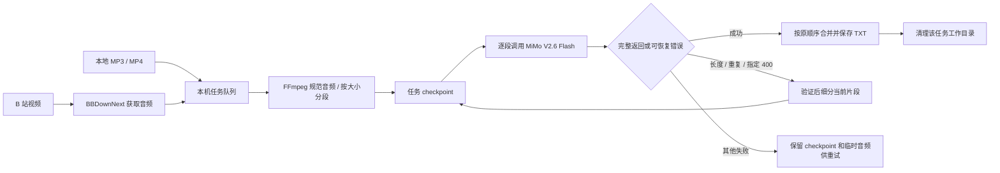

# BiliScribe 转写技术方案与 Agent 交接

这份说明供后续 Codex 对话或本地 Agent 接手时使用。描述以当前代码为准；MiMo 的 API Key、完整 Prompt 和音频内容不应放进对话、文档或命令日志。

## 当前方案概览

BiliScribe 把“找音频、处理音频、调用模型、保存结果”放在本机 Node.js 后台完成。网页主要负责让人选择来源和查看状态。B 站任务由 BBDownNext 获取音频；本地任务直接读取本机音频或视频。两条路径汇入同一套 FFmpeg 规范化、串行队列、MiMo 转写、checkpoint 恢复和 TXT 保存流程。



设计重点是把昂贵的模型请求限制在一个可恢复的后台流程里：队列一次只运行一个任务，单个任务按片段顺序请求；每段成功后就落盘并更新 checkpoint。失败后可以重试已失败段，不需要重新付费生成已经完成的段。75 个文件可以一次创建成一批任务，但仍会逐个排队处理；当前自动化验证覆盖了批量上限与队列逻辑，尚未对 75 个真实 MiMo 任务做端到端压力验收。

## 从输入到文字稿

### 1. 创建任务与取得源音频

- 本地导入入口是“本地音视频”。目前允许 MP3、M4A、WAV、FLAC、OGG、MP4。选择文件夹只扫描当前层级；后端校验扩展名，批量创建最多接受 3000 项。
- MP4 在任务开始时用 FFprobe 检查第一条音轨。缺少音轨、损坏或不可解码时，该任务给出明确错误，队列继续处理下一项。
- 本地文件以原路径只读使用。原始视频不复制覆盖、不改写、不删除。
- B 站文字稿任务先复用同一 BVID 已完成的音频下载；没有可复用音频时，由 BBDownNext 将音频下载到该任务工作目录。

相关代码：[`server/local-media.js`](../server/local-media.js)、[`server/api.js`](../server/api.js) 中的 `selectLocalAudio()`、`createLocalAudioTasks()`、`runTranscriptTask()`。

### 2. FFmpeg 规范音频

输入音频被转换为 AAC 编码的 M4A：16 kHz、单声道、32 kbps。MP4 只映射第一条音轨，并用 `-vn` 排除画面。核心参数由 `buildLocalAudioPreparationArgs()` 统一构造：

```js
[
  '-i', sourcePath,
  '-map', '0:a:0', '-vn',
  '-ac', '1', '-ar', '16000', '-c:a', 'aac', '-b:a', '32k',
  outputPath,
]
```

音频 Base64 的硬上限是 40,000,000 字节；常规预分段目标使用 38,000,000 字节安全值。文件超过上限时先在任务工作目录内切段，避免一次把整段超大音频送到 API。所有规范化和分段临时文件都位于 `.biliscribe/transcript-work/<taskId>/` 下。

### 3. MiMo 请求与输出检查

每个音频段复用同一请求实现，不为 MP4 建第二套转写系统：

- 地址：`https://api.xiaomimimo.com/v1/chat/completions`
- 模型：`mimo-v2.6-flash`
- 流式响应；`max_completion_tokens: 131072`；关闭 thinking。
- Prompt 从 `prompts/bazi-transcript.md` 读取，并由后台补充“只返回本段正文、按原顺序”的任务说明。
- API Key 从本机 BiliScribe 状态目录的 `secrets.json` 载入；不会返回给前端，也不应交给 Codex 对话。
- 后台按 SSE 逐块写入任务专属的临时输出文件。只有模型符合预期、`finish_reason` 为 `stop` 且文本非空时，才把该段标记成功。

请求入口为 `callMiMoForSegment()`。网络中断、超时和部分无效响应最多尝试三次；HTTP 429 与 5xx 有退避重试。普通 HTTP 400 不会一概自动重试。

请求骨架（省略真实 Prompt、Base64 和密钥）：

```js
const body = {
  model: 'mimo-v2.6-flash',
  stream: true,
  stream_options: { include_usage: true },
  max_completion_tokens: 131072,
  thinking: { type: 'disabled' },
  messages: [
    { role: 'system', content: `${prompt}\n\n只返回本段修正后的完整正文。` },
    { role: 'user', content: [
      { type: 'input_audio', input_audio: { data: 'data:audio/mp4;base64,…', format: 'm4a' } },
      { type: 'text', text: '请按原话顺序转写本段，不要总结。' },
    ] },
  ],
}
```

### 4. 分段、checkpoint 与恢复

checkpoint 保存输入指纹、源音频哈希、Prompt 哈希、处理版本、按顺序排列的分段、已完成段和当前段。更新先写临时文件再原子改名。每段文本也单独落盘；进程重启后，成功段保留，失败任务可以点击重试，从首个未完成段继续。

单段成功的关键顺序是：先拿到并校验完整响应，再写该段文字，最后把段 ID 放入 `completedSegments` 并保存 checkpoint。拆分时相反地先生成并验证两个子音频，然后才用两个子段替换 checkpoint 中的父段。这样中断时不会把“未完整的结果”误标成已完成。

自适应拆分只处理已识别的几类情况：MiMo 输出 `length`、`repetition_truncation`、`content_filter`，以及 HTTP 400 且服务端错误消息精确为 `Param Incorrect`。普通 HTTP 400 不会因为状态码相同就盲目拆分。多数拆分最多 10 层、子段下限 8 分钟；`content_filter` 使用独立上限 4 层和 1 秒下限。

自适应拆分使用两个明确的起始时间和时长生成前后半段，不依赖 FFmpeg 自动分段器凑出两个文件。checkpoint 只在两个子文件均存在、非空、可被 FFprobe 读取、时长合理、音轨格式正确且 Base64 未超限后才更新。任一步骤失败会删除无效子片段，保留原段与旧 checkpoint。

主要代码：[`server/transcript-adaptive.js`](../server/transcript-adaptive.js)、[`server/transcript-split.js`](../server/transcript-split.js) 和 `server/api.js` 中的 `splitTranscriptSegment()`。

### 5. 合并、保存与清理

所有段成功后按 checkpoint 顺序合并文本，清理标注并写入 TXT 与文字稿库。保存成功后，只清理当前任务专属工作目录。失败时保留 checkpoint、已完成段文字与恢复所需音频；队列将错误记到任务上并继续下一项。清理逻辑限定在 `.biliscribe/transcript-work/<taskId>/`，不触碰输入媒体或其他任务目录。

本地多文件批次会有共同 `batchId` / `batchName`，文字稿库据此收纳到一个文件夹。相关入口见 `transcriptOutputDirectory()`、`listTranscripts()` 和 [`src/App.vue`](../src/App.vue)。

## 之前遇到的问题与结论

1. **文件选择器曾屏蔽 MP4。** 后端扩展名已经支持 MP4，但 Windows 原生文件对话框过滤条件仍是旧格式；后续将后端校验、文件夹扫描和选择器过滤统一维护在 `server/local-media.js`。遇到“代码支持、界面选不到”时，要同时检查原生对话框过滤器和正在运行的后台进程。
2. **Windows 可能仍运行旧后台。** GitHub 更新或前端重建，不代表 4174 端口服务已换成新代码。排查时应确认当前仓库 HEAD、监听端口 PID、Node 启动命令和实际 `server/api.js` 路径；只停止已确认属于 BiliScribe 的进程。
3. **长音频出现过 HTTP 400 / `Param Incorrect`。** 约 152 分钟视频被初步处理成两个约 76 分钟片段，其中一段得到服务端 `Param Incorrect`。这个观测本身不能证明“音频长度就是原因”，所以错误处理按服务端消息精确识别；不能把所有 400 都当成长度问题。
4. **FFmpeg 自动分段器未稳定生成恰好两个子片段。** 4570.048 秒段的旧拆分曾失败。现在按明确起点与持续时间分别生成两段，并检查数量、时长、大小和音轨后才提交 checkpoint。
5. **异常生成量会误导进度判断。** 曾看到运行中显示约 133,875 个“已生成字”。它是尚未保存的模型输出字符进度，不等于最终 TXT 字数或汉字数。应同时看 `finish_reason`、usage、输出首尾和重复片段诊断；发生重复或截断时只把成功完成的段保留。当前重复率指标用于诊断；拆分触发依赖 MiMo 的 `finish_reason`，并非任何高重复文本都会自动被拦截。
6. **HTTP 错误日志之前只有通用状态码。** 当前读取最多 8 KiB 错误响应、最多等待 2 秒，记录经过清理的服务端 code/type/message 和 request ID，不记录 Key、音频 Base64、Authorization、Prompt 或原始请求体。日志中的输出诊断仍可能包含少量文字稿片段，分享日志前应检查并脱敏。

一次拆分失败或模型异常时，先保留原媒体、checkpoint 和工作目录，再根据 `taskId` 找到日志中的输入诊断、HTTP 错误、`Transcript adaptive split planned/failed/verified` 与分段完成记录。不要先删临时文件或重建任务，否则可能丢失已完成段并增加重复 API 费用。

## 让 Codex Agent 以后直接使用的建议

推荐第一步让 Agent 调用**本机 BiliScribe 转写服务**，而不是让 Agent 自己重新拼一套 MiMo 请求。这样 API Key 继续留在后台本机配置里，FFmpeg、Prompt、分段、串行队列和 checkpoint 也继续复用。

当前后端已经提供任务与文字稿查询接口（`GET /api/tasks`、`GET /api/transcripts`），但本地任务创建依赖 Windows 原生选择器生成的短时 `selectionId`；选择器本身会弹窗。因此这不是完整的无界面 Agent 接口。测试模式的上传接口也只用于隔离验收，不能当作正式任务入口。

后续最小演进可以增加一个本机 CLI 或仅绑定 `127.0.0.1` 的 Agent 适配层：接收本机媒体路径、任务标题和可选批次名，验证路径/格式/音轨后，把任务送进**现有同一个串行队列**；返回稳定 `taskId`，供 Agent 轮询进度、读取失败原因、重试/取消并取得 TXT。Agent 适配层不保存或打印 MiMo Key，不允许删除输入媒体，并应加入幂等标识，避免 Agent 重试提交时意外创建第二个收费任务。新增入口应复用 `runTranscriptTask()` 的处理链，不能复制一份 Prompt/API/拆分实现。

如果以后完全移除网页，建议把“任务队列 + 转写执行器”整理成后台共用能力，由网页和 Agent CLI/MCP 作为两个薄客户端。第一阶段可先保留网页作为人工控制台；Agent 能力稳定后再决定是否移除网页。直接让 Codex 把媒体转成 Base64 并调用 MiMo，会要求 Agent 侧额外管理 Key 和整个恢复过程，也容易造成与当前流程参数、分段和错误处理不一致。当前后台绑定 `127.0.0.1`；未来的 Agent 入口也应保持本机可达，不要直接暴露到公网。

## 本机自动化测试边界

[`TESTING.md`](../TESTING.md) 和 `npm run test:local` 使用隔离端口与 `.biliscribe-test/` 数据目录。测试环境不读取正式 MiMo Key，转写结果是确定的模拟文本，不调用 MiMo，因此不产生 MiMo API 费用；它能检查导入、FFmpeg、队列进度、错误显示和文字稿查看，不能证明真实识别质量、真实 B 站下载或真实 API 费用。真实 MiMo 请求会产生费用；长音频细分、网络重试或手动重复创建任务都可能增加调用量。

用户提供的本机真实素材目录记录在本机忽略文件 `TEST_HANDOFF.local.md` 中，供后续人工授权的真实素材检查挑选较短文件；该路径只对这台 Windows 电脑有效，不进入 GitHub。

## 代码索引

| 内容 | 代码位置 |
| --- | --- |
| 本地扩展名、MP4 音轨探测、FFmpeg 规范参数 | [`server/local-media.js`](../server/local-media.js) |
| MiMo 请求、SSE、任务执行、checkpoint、拆分与队列 | [`server/api.js`](../server/api.js) |
| HTTP 错误体限长读取及脱敏 | [`server/mimo-http-error.js`](../server/mimo-http-error.js) |
| 拆分原因、最大深度与替换 checkpoint 段 | [`server/transcript-adaptive.js`](../server/transcript-adaptive.js) |
| 显式 FFmpeg 子段时间范围与验证 | [`server/transcript-split.js`](../server/transcript-split.js) |
| 输出清理和重复内容诊断 | [`server/transcript-text.js`](../server/transcript-text.js) |
| Prompt | [`prompts/bazi-transcript.md`](../prompts/bazi-transcript.md) |
| 页面导入、进度、文字稿展示 | [`src/App.vue`](../src/App.vue) |
| 本地媒体、MiMo 错误、分段、文字处理测试 | `server/*test.js` |
